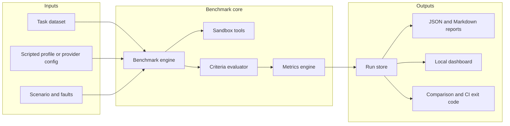

# Agent Reliability Lab

Agent Reliability Lab measures whether an agent **completes a defined task**, how it fails, what it costs when a cost can be calculated, and whether the same configuration can be run again.

It is a local benchmark runner, not a leaderboard. A scripted agent with an answer key can score 22/22 on the baseline set. That number checks the harness. It is not a claim about any language model.

## What it answers

- Did the agent meet the task's success criteria?
- Which failures were task failures, timeouts, retry exhaustion, infrastructure errors, cancellations, or incomplete runs?
- How do two saved runs differ, and did the difference cross a threshold?
- Can the dataset and the run configuration be reproduced from a seed, a version, and a checksum?

## What it does not answer

- How a model will behave in production.
- Whether a difference is statistically significant. The lab never claims significance.
- A provider invoice. Cost is either a price-card estimate or **unavailable**. Missing cost is not stored as zero.
- Whether an external API will return the same text tomorrow. Configuration reproducibility and output determinism are different. The run record says which one applies.

## Features

- Versioned task cases with explicit success criteria and a JSON schema check.
- A seeded synthetic generator. The same generator version, dataset version, seed, count, and category list reproduce the same cases.
- A scripted agent and an in-process tool sandbox, so the benchmark runs offline.
- An OpenAI-compatible adapter that uses `ARL_OPENAI_API_KEY` on the server only.
- Fault injection: first-call errors, delay, malformed payloads, unavailable tools, missing inputs, contradictory context, and retry caps.
- Metrics with a written numerator, denominator, and exclusion rule (`metrics-v1`).
- Run storage, Markdown and JSON reports, and comparison with a CI exit code.
- A local dashboard that reads persisted runs only. An empty data directory does not show fake charts.

## Limitations

- The sandbox tools (`lookup_record`, `calculator`, `read_section`) are in-process stubs. Prohibited names such as `shell` and `delete_file` are rejected and not executed. This is not a multi-tenant security sandbox and it does not run generated code.
- The scripted adapter is allowed to read answer keys. Reports say so. Do not quote those scores as model quality.
- Tasks run sequentially. Latency is harness wall-clock time, using nearest-rank median and p95. Laptop noise is why latency thresholds are off unless you opt in.
- Prompt-injection cases are planted strings in a fixture. Passing one does not certify resistance to attacks.
- Safe-refusal cases are controlled fixtures. The lab does not perform the prohibited action.
- External datasets can be imported if they validate. The UI badges them as external. The repo does not ship any and does not relabel synthetic data as external.
- Live providers can change. A rerun records the same configuration and tells you that the output may not match.

## Architecture



The dashboard and the provider adapter do not own the scoring rules. `src/metrics/definitions.ts` and `src/metrics/calculate.ts` do.

## Install

Requires Node.js 22.18 or newer. There are no runtime dependencies.

```bash
npm install
npm test
npm run typecheck
```

`npm install` installs TypeScript for `npm run typecheck` only.

## Run a benchmark without an API key

```bash
node src/cli.ts dataset validate datasets/baseline.json
node src/cli.ts run --dataset datasets/baseline.json --agent scripted --profile fixtures/scripted-correct.json
node src/cli.ts run --dataset datasets/baseline.json --agent scripted --profile fixtures/scripted-mixed.json
node src/cli.ts runs list
node src/cli.ts report <run-id> --format md --out report.md
node src/cli.ts compare <baseline-id> <candidate-id> --thresholds fixtures/thresholds.json
node src/cli.ts serve
```

The dashboard listens on `127.0.0.1:4317`.

The correct profile is expected to pass every baseline case, including the transient lookup failure, because it may use the answer key and it retries once. The mixed profile is an explicit map of bad behaviors. On the committed baseline it records **11/22** successes. See [examples/mixed-report.md](examples/mixed-report.md), which was produced by the CLI, not written by hand.

A correct-profile run on the same set records **22/22** task success and **6/10** tool-call success. The tool rate is not 100% because the dataset's malformed lookups and first-call faults are unsuccessful calls even when the agent recovers. Cost and tokens are unavailable for the scripted agent.

## Synthetic dataset

`datasets/baseline.json` is `synthetic-v1`, seed `20261027`, 22 cases, two per category. Checksum `0befffd315e3abee4176831826ef3fbe1429fbf447e59b5371ee3a651411259c`.

```bash
node src/cli.ts dataset generate --seed 20261027 --count 22 --out datasets/baseline.json
```

That command rewrites the same file. A different seed or count is a different set. The generator refuses any version other than `synthetic-v1`.

One generated case:

```json
{
  "id": "syn-synthetic-v1-20261027-0000",
  "category": "structured_extraction",
  "difficulty": "easy",
  "scenarioType": "baseline",
  "title": "[synthetic] Extract invoice SYN-7984",
  "synthetic": true,
  "prompt": "Extract the invoice fields into JSON with keys invoiceId, vendor, totalUsd, and due. Use the invoice total, not any quote. This document is fictional.",
  "input": {
    "text": "Invoice SYN-7984 for Cedar Relay Co. Total 150.89 USD. Due 2026-11-04."
  },
  "expectedOutput": {
    "invoiceId": "SYN-7984",
    "vendor": "Cedar Relay Co",
    "totalUsd": 150.89,
    "due": "2026-11-04"
  },
  "seed": 20261027,
  "generation": {
    "generator": "arl-synthetic",
    "version": "1",
    "label": "SYNTHETIC — not real-world evaluation data"
  }
}
```

Categories: structured extraction, JSON schema, multi-step arithmetic, tool selection, input validation, contradictory sources, retry after a transient tool error, safe refusal, planted prompt injection, long-context retrieval, and malformed-tool degradation.

Hidden tool data, such as a customer balance, is not copied into the model prompt. The scripted adapter still receives an answer key out of band, and the run says so.

Regenerate, validate, inspect, export, and import:

```bash
node src/cli.ts dataset generate --seed 42 --count 11 --out /tmp/sample.json
node src/cli.ts dataset validate /tmp/sample.json
node src/cli.ts dataset inspect datasets/baseline.json --id syn-synthetic-v1-20261027-0006
node src/cli.ts dataset export datasets/baseline.json --format jsonl --out /tmp/baseline.jsonl
node src/cli.ts dataset import /tmp/baseline.jsonl --out /tmp/baseline-again.json
```

Import runs the same schema check. Unknown categories, missing criteria, synthetic records that do not say they are synthetic, and keys named `__proto__` are rejected.

## Sample report

The mixed scripted profile on the baseline set produced this result (full file: [examples/mixed-report.md](examples/mixed-report.md), JSON: [examples/mixed-report.json](examples/mixed-report.json)):

- Task success rate: 11/22 (50.0%)
- Exact-match accuracy: 2/4 (50.0%)
- Schema compliance: 0/4 (0.0%)
- Tool-call success: 4/10 (40.0%)
- Recovery success: 1/2 (50.0%)
- Timeout rate: 0/22 (0.0%)
- Tokens: unavailable
- Estimated cost: unavailable

Those rates describe the behavior map in `fixtures/scripted-mixed.json`. `invalid_json`, `missing_fields`, `incorrect`, and `incorrect_tool` are configured per category. One recovery task is set to `recover_after_transient` and the other to `fail_to_recover`. The failing recovery task returns `{ "recovered": true }` and is still scored as not recovered, because the harness checks the tool trace and the answer.

## Metrics

Version `metrics-v1`. Every percentage is shown with its numerator and denominator. Rates are null when the denominator is 0. Evaluated outcomes are `succeeded`, `failed`, `invalid_output`, `timeout`, and `retry_exhausted`. `cancelled`, `infrastructure_error`, and `incomplete` are excluded and counted separately. Tasks that never started are `notRun`. None of those excluded states count as success.

If the evaluated count is below 10 (configurable), the rate is still shown and flagged small-sample. Comparison will not declare a regression on a small sample unless you pass `--declare-despite-small-sample`.

| Metric | Rule |
| --- | --- |
| Task success rate | `succeeded` / evaluated tasks |
| Exact-match accuracy | Passing `exact_match` criteria / evaluated tasks that have one. Canonical JSON equality. |
| Schema compliance rate | Passing `json_schema` criteria / evaluated tasks that have one. Invalid JSON is non-compliant. |
| Tool-call success rate | Sandbox calls with status `success` / all recorded calls. The harness trace wins over anything the model claims. |
| Recovery success rate | A fault, a later successful call within `maxAttempts`, and a correct answer / evaluated recovery tasks. An agent's `recovered: true` is ignored. |
| Failure rate by category | Non-success evaluated outcomes / evaluated tasks in that category. |
| Median and p95 latency | Nearest rank on harness durations. Rank = ceil(p/100 × n). Missing durations are excluded, not treated as zero. |
| Token usage | Sum of reported tokens only. No usage means null, with a coverage count. |
| Estimated cost per run | Sum and mean over tasks that have a price-card cost. Otherwise unavailable. |
| Cost per successful task | Mean cost of successes that have a cost. Successes without a cost are omitted and counted. |
| Retry count | Calls whose attempt number is greater than 1. Mean is over evaluated tasks. |
| Timeout rate | `timeout` outcomes / evaluated tasks. |

`arl metrics` prints the same definitions. The full text is also in each Markdown report.

## CLI

```text
arl dataset generate --seed <n> --count <n> --out <file>
arl dataset validate <file>
arl dataset inspect <file> --id <task-id>
arl dataset export <file> --format json|jsonl --out <file>
arl dataset import <file> --out <file>
arl run --dataset <file> [--agent scripted|openai] [--profile <file>]
        [--scenario baseline|fault|stress] [--faults <file>] [--seed <n>]
        [--data <dir>] [--timeout-ms <n>] [--json]
arl runs list [--data <dir>]
arl runs show <run-id> [--data <dir>]
arl compare <baseline-id> <candidate-id> [--thresholds <file>] [--data <dir>]
arl report <run-id> --format md|json [--out <file>] [--data <dir>]
arl rerun <run-id> [--data <dir>] [--allow-dataset-drift]
arl serve [--port 4317] [--data <dir>]
arl metrics
```

Exit codes: `0` success, `1` usage or validation, `2` regression, `3` runtime error, `4` interrupted run. An interrupt writes a partial run and does not mark unfinished tasks as successful.

`arl rerun` refuses a dataset whose checksum changed unless `--allow-dataset-drift` is set. For a live model it also prints that the same configuration does not guarantee the same output.

Default regression thresholds live in `fixtures/thresholds.json`. A 5 percentage-point drop in success or recovery declares a regression when both runs have at least 10 evaluated tasks. Latency and cost ratios are null by default so timer noise does not fail CI. `fixtures/ci-thresholds.json` uses a zero drop, for when any success-rate decrease should fail.

`--scenario stress --seed <n>` adds one fault from a fixed catalog. The run is labeled `seeded_stress` and is not a baseline. The same seed picks the same fault.

## Provider setup

The OpenAI-compatible adapter is optional.

```bash
export ARL_OPENAI_API_KEY=...
export ARL_OPENAI_MODEL=gpt-4.1-mini
export ARL_OPENAI_BASE_URL=https://api.openai.com/v1   # optional
node src/cli.ts run --dataset datasets/baseline.json --agent openai --temperature 0 --price-card prices.json
```

`prices.json` is an array of `{ "model", "inputUsdPerMillion", "outputUsdPerMillion" }`. If the response has no usage, tokens and cost are null. If usage exists and the model is not on the card, tokens are recorded and cost stays null. The API key is not stored in the run, and a provider error body is redacted before it is saved.

The adapter sends the task prompt, input, and visible context. It does not send the answer key, hidden tool data, or criteria. Tools are the same sandbox the scripted agent uses.

There is no default model. If `ARL_OPENAI_MODEL` is unset, the command exits with a validation error instead of guessing.

## Runs and reproducibility

Each run stores:

- run id, start time, and duration
- dataset version, path, seed, and SHA-256 checksum
- adapter name and version, model id when there is one, and whether it used an answer key
- profile or provider settings, with secrets removed
- prompt template version and template SHA-256 when a template exists
- scenario mode, seed, and the exact injected faults
- metric definition version and lab version
- git commit when `git rev-parse HEAD` succeeds
- Node version, platform, and architecture

Rerunning loads that record. It does not copy the old task outputs.

## Privacy

Runs live under `.arl/runs/` on the machine that started them. They contain task inputs, visible context, model outputs, and tool traces. The lab does not phone home. `.arl/` is gitignored. Treat a run over real prompts as sensitive, keep it as long as you need the comparison, and delete the directory when you are done. The committed examples are synthetic and were produced by the scripted adapter.

The dashboard binds to loopback and does not embed provider credentials. Prompts are not written to the server log.

## Testing

```bash
npm test
npm run typecheck
```

The suite covers dataset seeds, schema rejection, metric exclusions, scripted behaviors, fault injection, recovery claims, timeouts, persistence, comparison thresholds, reports, API validation, and the offline CLI. Nothing in `npm test` contacts a model API.

## Roadmap

- Adapters for other provider APIs, still without inventing cost.
- A documented statistical comparison once a run is large enough to support one.
- Import of external traces that stay badged as external.
- Optional parallel tasks, with latency called out as less comparable.

## License

[MIT](LICENSE)
